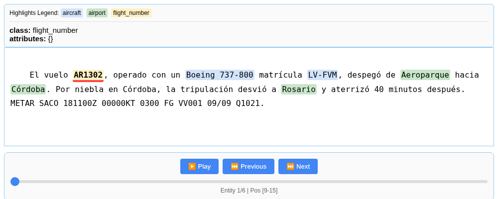
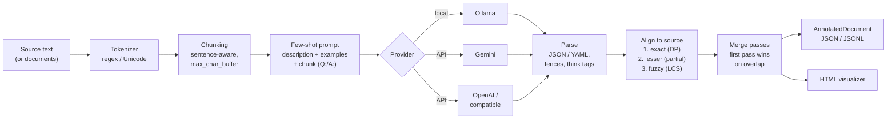
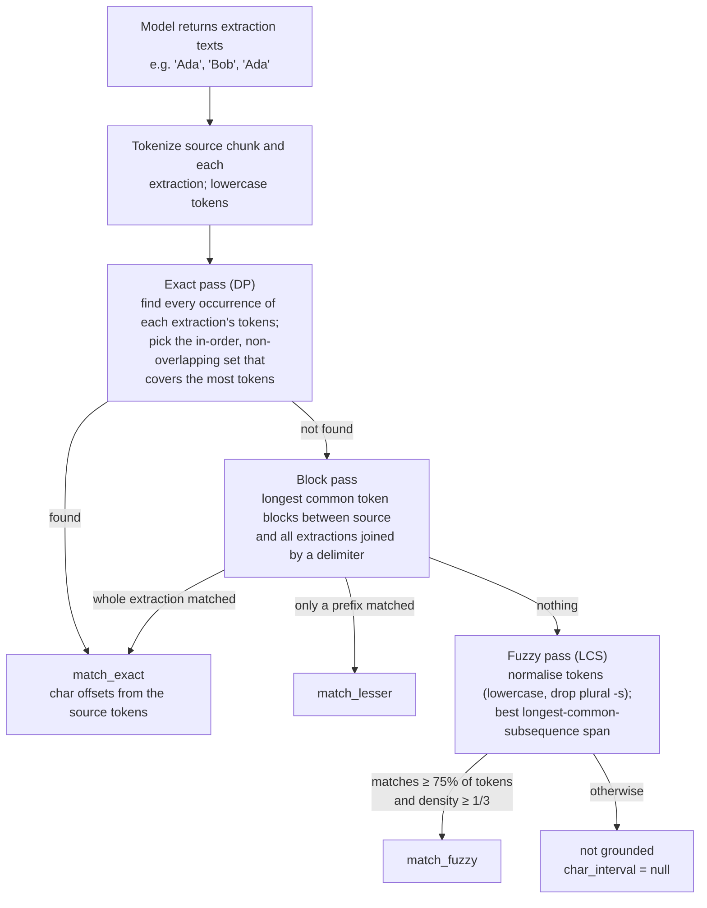

<div align="center">

# extract-rust

**Pull structured entities out of free text with an LLM, and ground each one to its exact offsets in the source.**

[](https://github.com/elianlehoux/extract-rust/actions/workflows/ci.yml)
[](https://www.rust-lang.org)

[](LICENSE)
[](#other-providers)

</div>

**Status: in development.** Usable and tested, but the API may still change.

`extract-rust` is a Rust port of Google's [LangExtract](https://github.com/google/langextract): a library and a CLI that use an LLM to pull structured entities out of free text (people, medications, METAR groups, whatever your few-shot examples define) and then **ground every extraction to its exact character offsets in the source text**. When the model invents something, that extraction gets no offsets (`char_interval: null`), so it is easy to spot.

It is an independent port, not an official Google project. LangExtract is Copyright 2025 Google LLC, Apache-2.0; see [NOTICE](NOTICE).

<p align="center">
  <br>
  <sub>The built-in HTML visualizer on a Spanish flight report.</sub>
</p>

## Features

- **Source grounding**: exact and fuzzy alignment of every extraction to character offsets; invented text gets no offsets.
- **Long documents**: sentence-aware chunking with a context window, parallel workers and multiple extraction passes.
- **Providers**: Ollama (local), Gemini and OpenAI or OpenAI-compatible servers, behind one `LanguageModel` trait.
- **CLI and library**: the `extract` binary (JSON or YAML output) and a Rust API.
- **Review**: a self-contained HTML visualizer and JSONL save/load of annotated documents.
- **Evaluated**: compared against upstream Python LangExtract on a hand-annotated set (see [Evaluation](#evaluation)).

## Quickstart

Requirements: Rust 1.88+ and, for local models, [Ollama](https://ollama.com).

```bash
git clone https://github.com/elianlehoux/extract-rust && cd extract-rust
ollama pull gemma2:2b
cargo install --path crates/extract-cli      # installs the `extract` binary

extract -m gemma2:2b \
  -p "Extract people and their roles" \
  -e examples/people.json \
  --file examples/note.txt \
  --html review.html
```

Real output from that command (gemma2:2b on CPU, 18 s; trimmed to two of the five entities):

```json
{
  "extractions": [
    {
      "extraction_class": "person",
      "extraction_text": "Ada Lovelace",
      "char_interval": { "start_pos": 0, "end_pos": 12 },
      "alignment_status": "match_exact",
      "extraction_index": 1,
      "group_index": 0,
      "description": null,
      "attributes": { "role": "collaborator with Charles Babbage on the Analytical Engine" }
    },
    {
      "extraction_class": "person",
      "extraction_text": "Margaret Hamilton",
      "char_interval": { "start_pos": 178, "end_pos": 195 },
      "alignment_status": "match_exact",
      "extraction_index": 3,
      "group_index": 2,
      "description": null,
      "attributes": { "role": "director of software engineering at MIT" }
    }
  ],
  "text": "Ada Lovelace collaborated with Charles Babbage on the Analytical Engine in London. ...",
  "document_id": "doc_2d47805d"
}
```

Full output: [docs/people-output.json](docs/people-output.json).

### Aviation example (Spanish)

```bash
extract -m gemma2:2b \
  -p "Extract flight numbers, aircraft (type or registration) and airports, in order of appearance. Use the exact text from the source." \
  -e examples/flight_report.json --file examples/flight_report.txt --html docs/flight_report.html
```

Real result (the screenshot above is its HTML):

| class | text | offsets | status |
|---|---|---|---|
| flight_number | AR1302 | 9–15 | match_exact |
| aircraft | Boeing 737-800 | 32–46 | match_exact |
| aircraft | LV-FVM | 57–63 | match_exact |
| airport | Aeroparque | 76–86 | match_exact |
| airport | Córdoba | 93–100 | match_exact |
| airport | Rosario | 149–156 | match_exact |

The model missed the second mention of "Córdoba". Grounding cannot fix recall; it only tells you where what was found is.

### Other providers

```bash
export GEMINI_API_KEY=...        # or LANGEXTRACT_API_KEY
extract -m gemini-2.5-flash -p "..." -e examples/people.json --file examples/note.txt

export OPENAI_API_KEY=...        # OPENAI_BASE_URL for OpenAI-compatible servers
extract -m gpt-4o-mini -p "..." -e examples/people.json --file examples/note.txt
```

The provider is inferred from the model id (`gemini*`, `gpt-*`/`o1..o9`, and `gemma`, `llama`, `qwen`, `mistral`... for Ollama) or forced with `--provider`. Each provider reads only its own key variable. Gemini and OpenAI are covered by tests against a local mock HTTP server, but **the evals below were only run with local Ollama models**.

Useful flags: `--text "..."` or stdin, `--output out.json`, `--html review.html`, `--format yaml`, `--max-char-buffer 1000`, `--extraction-passes 2`, `--context-window-chars 200`, `--base-url`.

### Few-shot examples file

A JSON array of `{text, extractions}`. Each `extraction_text` should appear verbatim in its `text`; the CLI checks this before calling the model and prints a warning when it does not.

```json
[
  {
    "text": "Alan Turing was an English mathematician and computer scientist who worked at Bletchley Park.",
    "extractions": [
      {
        "extraction_class": "person",
        "extraction_text": "Alan Turing",
        "attributes": { "role": "mathematician and computer scientist", "workplace": "Bletchley Park" }
      }
    ]
  }
]
```

## Library

```toml
[dependencies]
extract-core = { git = "https://github.com/elianlehoux/extract-rust" }
extract-providers = { git = "https://github.com/elianlehoux/extract-rust" }
```

```rust
use extract_core::extract::{extract, ExtractInput, ExtractOptions, ExtractResult};
use extract_core::types::{ExampleData, Extraction};
use extract_providers::{create_model, ModelOptions};

fn main() -> Result<(), Box<dyn std::error::Error>> {
    let examples = vec![ExampleData::new(
        "Alan Turing worked at Bletchley Park.",
        vec![Extraction::new("person", "Alan Turing")],
    )];
    let mut model = create_model("gemma2:2b", ModelOptions::default())?;

    let result = extract(
        ExtractInput::Text("Ada Lovelace wrote the first algorithm with Charles Babbage.".into()),
        "Extract people mentioned in the source text",
        &examples,
        model.as_mut(),
        ExtractOptions { fence_output: false, ..ExtractOptions::default() },
    )?;

    if let ExtractResult::Document(doc) = result {
        for ext in doc.extractions.unwrap_or_default() {
            println!("{} {} {:?} {:?}", ext.extraction_class, ext.extraction_text,
                     ext.char_interval, ext.alignment_status);
        }
    }
    Ok(())
}
```

A runnable version that also prints the matched source span is [`crates/extract-cli/examples/library.rs`](crates/extract-cli/examples/library.rs) (`cargo run -p extract-cli --example library`). Its real output:

```text
person   Ada Lovelace     [0..12] "match_exact" -> source: "Ada Lovelace"
person   Charles Babbage  [44..59] "match_exact" -> source: "Charles Babbage"
```

Results can be saved and reloaded as JSONL (`save_annotated_documents`, `load_annotated_documents_jsonl`) and rendered with `visualize(&doc)`.

## How it works



([PNG](docs/pipeline.png))

In plain words:

1. **Tokenize.** The text is split into words, numbers and punctuation, and each token remembers its position. Positions are Unicode character indices, like Python's, so `"José"` has length 4 and offsets match LangExtract.
2. **Chunk.** Long texts are cut into pieces of at most `max_char_buffer` characters (1000 by default) at sentence boundaries; a sentence that is too long is split at token boundaries. Each chunk remembers its offset in the document.
3. **Prompt.** For each chunk, the prompt is the task description, the few-shot examples as `Q: text` / `A: {"extractions": [...]}` pairs, and finally `Q: <chunk>` / `A:` for the model to complete. Optionally the end of the previous chunk is included as context (`context_window_chars`) to resolve pronouns.
4. **Call the model.** Chunks are sent in batches (`batch_length`, default 10) through a `LanguageModel` trait, with a configurable number of parallel HTTP workers. The core crate has no HTTP code; Ollama, Gemini and OpenAI are separate implementations of that trait, and tests use scripted fake models.
5. **Parse.** The answer is read as JSON or YAML, with or without code fences, ignoring `<think>` blocks. Each item `{"person": "Ada", "person_attributes": {...}}` becomes an `Extraction`. A malformed chunk is skipped with a warning by default (`suppress_parse_errors`) instead of failing the document.
6. **Align.** The model returns text, not positions, so each extraction is searched for in the chunk (below). Offsets are shifted by the chunk offset so they refer to the whole document.
7. **Merge and output.** With several passes (`extraction_passes`), the first pass wins and later passes only add non-overlapping extractions. The result is an `AnnotatedDocument`, written as JSON/JSONL or as a self-contained HTML page.

### The alignment algorithm



([PNG](docs/alignment.png))

All matching is done on lowercased tokens, not raw characters, so case, spacing and punctuation differences do not break it. Character offsets come from the first and last matched tokens.

1. **Exact pass (dynamic programming).** For every extraction, find all places where its token sequence occurs in the chunk. Then choose one occurrence per extraction such that the chosen spans are in the same order the model listed them, do not overlap, and cover as many tokens as possible (a weighted longest-chain problem). This is why, for "Ada met Bob. Later Ada called Bob", the second "Ada" maps to the second mention instead of the first.
2. **Block pass.** Extractions still unplaced are matched with longest common token blocks between the chunk and all extraction texts joined by a separator token (`␟`, so a block cannot run across two extractions). A full match is `match_exact`; when only the beginning of the extraction matches, it is `match_lesser`.
3. **Fuzzy pass (LCS).** For what is left, tokens are normalised (lowercase, a trailing plural `-s` dropped) and the source span with the longest common subsequence is found. It is accepted only if it covers at least **75 %** of the extraction's tokens and the matched tokens make up at least **1/3** of the span (density), so scattered coincidences are rejected. Example: "Apollo software teams" grounds to "Apollo software team" as `match_fuzzy`.
4. **Otherwise**, the extraction keeps `char_interval: null`: most likely hallucinated or heavily paraphrased.

Known limitation (shared with upstream): if the model lists entities out of order, the exact pass can drop one and the fuzzy pass then picks the *first* occurrence. In the evals this happened once, with "Córdoba" in "Universidad Nacional de Córdoba … en Córdoba".

## Evaluation

[`evals/`](evals/) has 20 hand-annotated texts (13 English, 7 Spanish, 86 entities) across four domains: people/organizations/locations, medications, METAR reports and flight reports. The runner computes entity precision/recall/F1 (class plus normalised text), **grounded F1** (offsets must also equal the gold ones) and **alignment accuracy** (of the correct entities, the share placed at the gold offsets). The same set was run through upstream Python LangExtract 1.7.1 with the same model, prompts, examples, temperature 0 and one worker, and scored by the same code.

Measured on 2026-10-18, 8-vCPU Intel Xeon VM, CPU-only Ollama, Q4_K_M GGUF models:

| model | implementation | P | R | F1 | grounded F1 | alignment acc. |
|---|---|---|---|---|---|---|
| gemma2:2b | extract-rust | 0.965 | 0.965 | **0.965** | 0.953 | 0.988 |
| gemma2:2b | LangExtract (Python) | 0.965 | 0.965 | **0.965** | 0.953 | 0.988 |
| qwen2.5:1.5b | extract-rust | 0.901 | 0.953 | **0.927** | 0.927 | 1.000 |
| qwen2.5:1.5b | LangExtract (Python) | 0.898 | 0.919 | **0.908** | 0.908 | 1.000 |

gemma2:2b by domain (extract-rust): flight reports 1.000, METAR 1.000, medications 0.955, people/orgs/places 0.905 F1. English 0.983, Spanish 0.929.

Both implementations produced identical extractions and offsets on 19 of 20 documents with each model. The remaining document differed because the model answered differently (an extra or differently labelled entity), not because of alignment. With only 86 entities, one entity moves F1 by about a point, so the qwen gap is within noise. Treat these numbers as a smoke test, not a benchmark.

Reproduce: see [evals/README.md](evals/README.md). Raw predictions and summaries are in [evals/results/](evals/results/).

## What's different from the original

Only measured or verifiable differences:

- **One native binary, no Python runtime.** The `extract` release binary is 7.4 MB (5.7 MB stripped) and links only libc/libgcc. The Python baseline environment (`pip install langextract`) was 246 MB with 57 packages.
- **Lower overhead outside the LLM.** Offline benchmark with a deterministic fake model, so only the library's own work (chunking, prompting, parsing, alignment) is measured; median of 3 runs, same machine:

  | input | extract-rust `extract()` | LangExtract `extract()` | peak RSS (Rust / Python) |
  |---|---|---|---|
  | 140 KB, 4,000 entities | 0.057 s | 0.677 s | 10.6 MB / 92 MB |
  | 700 KB, 20,000 entities | 0.266 s | 3.452 s | 35 MB / 122 MB |

  Both returned the same 20,000 extractions with identical offsets and statuses. Process start: `extract --help` < 0.01 s and 3.5 MB; `python -c "import langextract"` 0.40 s and 84 MB.
- **With a local LLM the model dominates.** On the gemma2:2b eval run back to back, total time was 164.8 s (Rust) vs 165.5 s (Python), so there is no end-to-end speed-up to claim there. The client process peaked at 7.2 MB vs 129 MB (Ollama itself not counted). Latency on this shared VM varied by up to about 30 % between runs of the same configuration.
- **Fixes not in upstream at the time of writing:**
  - Ollama + YAML: upstream sends `format: "yaml"`, which Ollama rejects with HTTP 500 (`expected "json" or a valid JSON Schema`). Here `format` is only sent for JSON and YAML relies on the prompt.
  - Upstream also sends `keep_alive` inside `options`, which Ollama logs as `invalid option provided`. Here it is only sent at the top level.

Bugs found and fixed in this port while testing it (each with a regression test): the Gemini API key travelled in the URL and showed up in transport errors (now sent in the `x-goog-api-key` header and redacted from errors); `--api-key` forwarded `LANGEXTRACT_API_KEY` to every provider; `</SCRIPT>` in uppercase could break out of the visualizer's script tag; chunking was quadratic in time and memory (22 s and 2.3 GB for 700 KB, now 0.27 s and 35 MB); and `OPENAI_BASE_URL` was ignored.

## Not yet supported

Compared with upstream LangExtract:

- **Schema constraints / `output_schema`.** Upstream can derive a JSON Schema from the examples (`use_schema_constraints`) or take one (`output_schema`) and send it to providers that support structured output, such as Gemini. Here Gemini only gets `responseMimeType: application/json`, OpenAI `response_format: json_object` and Ollama `format: "json"`.
- `fetch_urls` (downloading the input from a URL).
- Vertex AI and Gemini batch processing.
- The provider plugin system and custom provider registration by name (you can still implement the `LanguageModel` trait yourself).
- Debug logging and progress bars.
- Gemini and OpenAI are tested only against local mock servers; no live API runs are part of the tests or evals.

## Project layout

| crate | purpose |
|---|---|
| `crates/extract-core` | tokenizer, chunking, prompting, parsing, alignment, JSONL IO, HTML visualizer; no network code |
| `crates/extract-providers` | Ollama, Gemini and OpenAI clients implementing `LanguageModel` |
| `crates/extract-cli` | the `extract` binary, plus the `eval`, `bench_offline` and `library` examples |

```bash
cargo test --workspace                                    # unit tests
cargo clippy --workspace --all-targets -- -D warnings
cargo fmt --all -- --check
```

CI runs formatting, clippy, tests on Linux and macOS, and a build and test on the MSRV (1.88).

## License

Apache-2.0, see [LICENSE](LICENSE) and [NOTICE](NOTICE). Derived from LangExtract, Copyright 2025 Google LLC.
